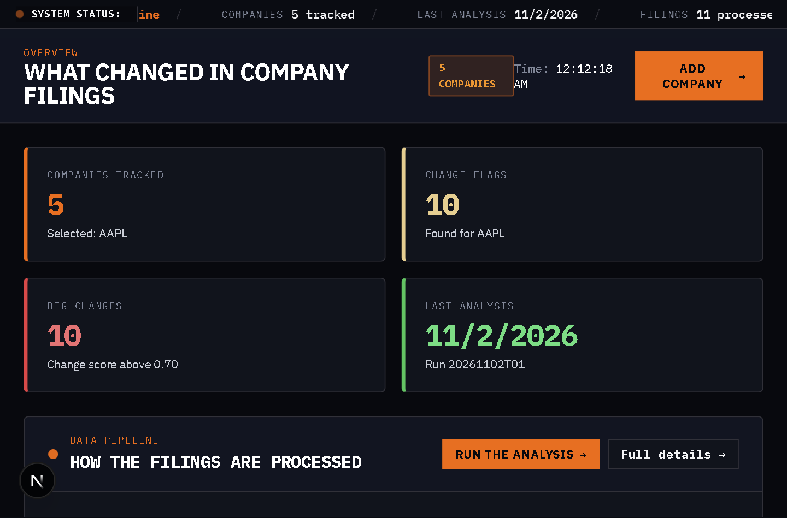
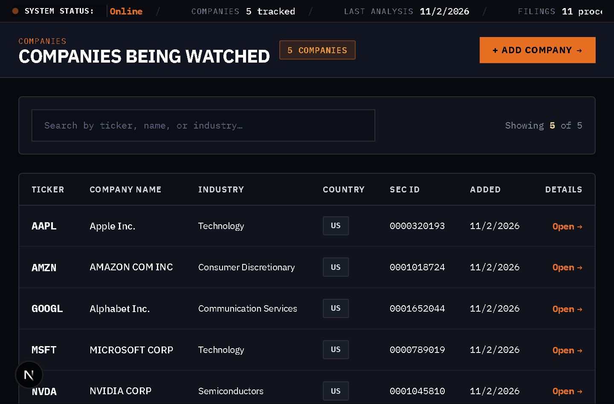
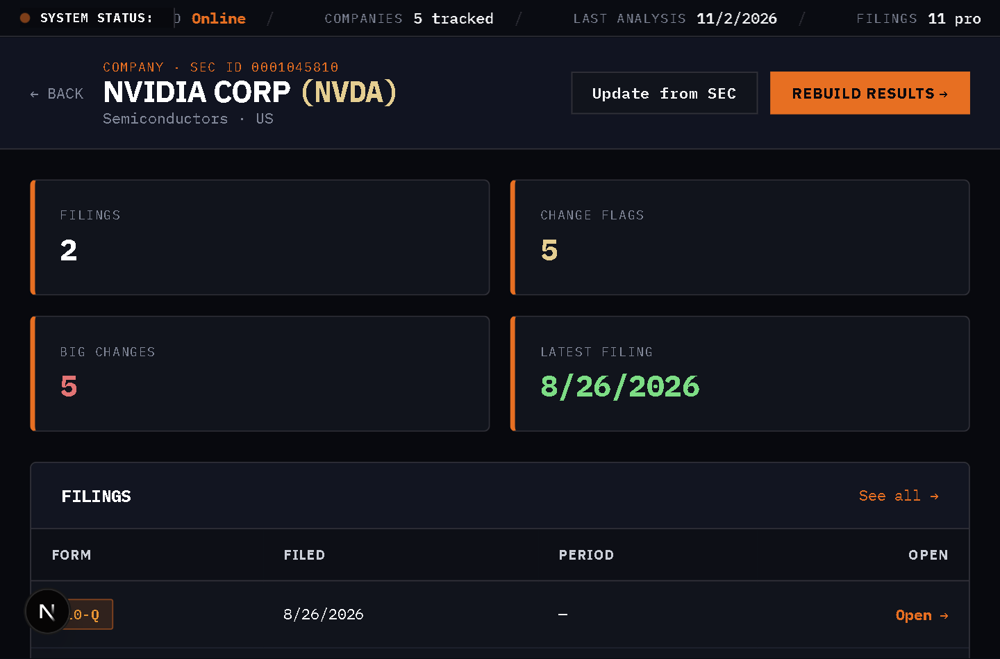
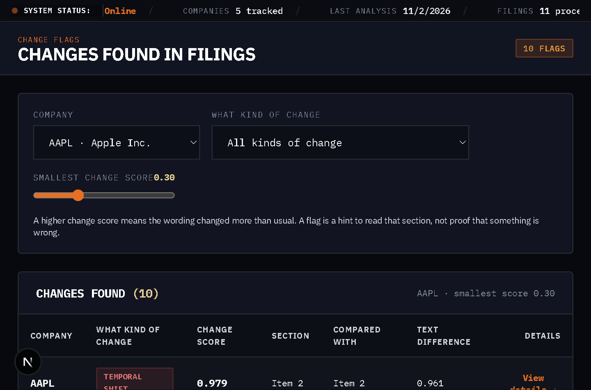
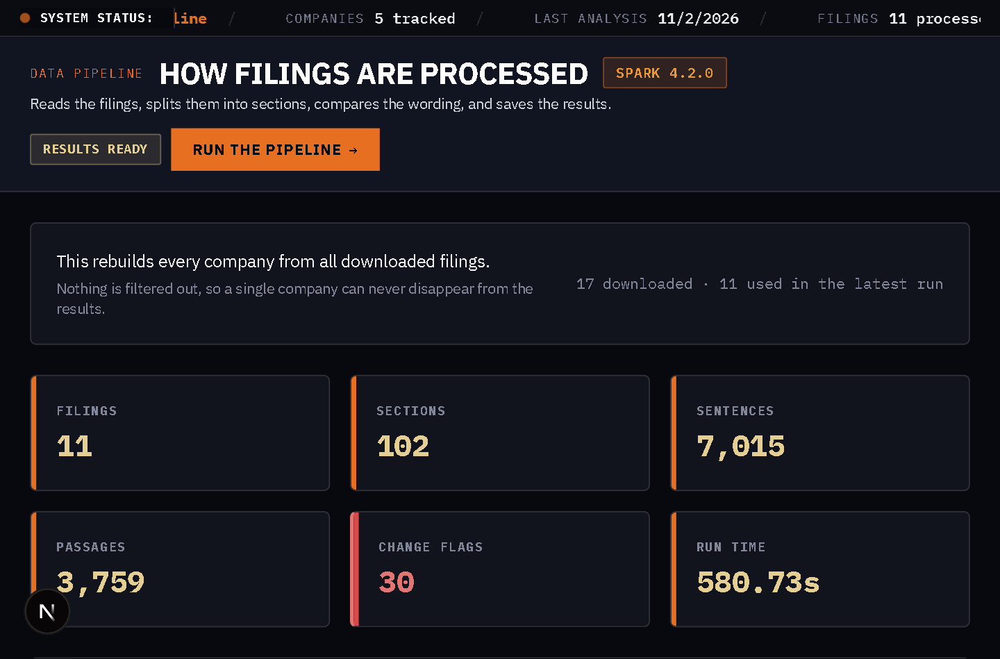

# Anomaly Engine

> **Mid-term demo (45%):** PySpark RDD pipeline → curated artifacts → FastAPI
> gateway → Next.js dashboard. See
> [docs/PYSPARK_RDD_PIPELINE.md](docs/PYSPARK_RDD_PIPELINE.md) for the pipeline,
> [docs/DEPLOYMENT.md](docs/DEPLOYMENT.md) to run it, and
> [docs/PYSPARK_API_REFERENCE.md](docs/PYSPARK_API_REFERENCE.md) for the Spark API list.

A **MERN-integrated financial anomaly detection engine** that ingests real SEC
EDGAR filings (10-K/10-Q) for AAPL and large-cap US issuers, computes
statistical anomaly scores over the filing text, and surfaces results through a modern
Next.js/React dashboard — with MongoDB as the raw-document store, Redis for
queueing/caching, and a Python/FastAPI compute core behind an API gateway.

> Native Windows development (blueprint/container stacks included via
> Docker Compose + GitHub Actions CI for production-shaped deploys).

## What it looks like

Screenshots of the running app. The numbers come from the committed pipeline
run `20261102T012655Z`, not from mock data.

| Dashboard | Companies |
|---|---|
|  |  |

| Company detail (NVDA) | Change flags |
|---|---|
|  |  |



## Brand / Positioning (one-liner)

> **"Anomaly Engine — turn SEC filings into tradable anomaly signals."**

## Stack (MERN + core)

| Layer | Tech | Role |
|-------|------|------|
| **M** | MongoDB 7.x (native service on :27017) | Raw filing docs, chunks, analysis manifest |
| **E** | Express / Node 24 | Mongo-backed secondary API (Express microservice) |
| **R** | React 18 + Next.js 16 (App Router) | Dashboard on :3000 |
| **N** | Node.js 24 runtime + NestJS-ready core | Service orchestration + backtester |
| Core | Python 3.11 / FastAPI / PyTorch | SEC EDGAR ingest, FinBERT NLP, anomaly + backtest |

Add-ons: Supabase/Postgres (primary persisted store), Redis Cloud (queue +
cache), pymongo/motor (async Mongo driver), SEM title/hero animations, real
SEC AAPL 10-Ks end-to-end.

## Architecture

```
                        ┌──────────────────────────────┐
   SEC EDGAR ──► ingestion-us (:8001) ──► Supabase (filings)
   Market    ──► ingestion-market (:8002)─► Supabase        │
                        └──────────────┬───────────────┘   │
                                       │                    │
                        ┌──────────────▼───────────────┐    v
                        │        api-gateway (:8000)   │──► MongoDB  ├── (raw filings/chunks)
                        └──────────────┬───────────────┘    anomaly_engine
                                       │
                        ┌──────────────▼───────────────┐
                        │   nlp-engine (:8003) FinBERT │──► anomalies
                        │   backtester (:8004)          │
                        └──────────────┬───────────────┘
                                       │
                              ┌────────▼────────┐
                              │ Next.js (:3000) │  MERN dashboard
                              └─────────────────┘
```

## Quick Start (Native Windows)

```powershell
# 1. Env (copy once)
Copy-Item .env.example .env   # fill Supabase/Redis/Finnhub/SEC keys + MONGODB_URI

# 2. Database + cache
#    - MongoDB:  ensure `mongod` service runs on 127.0.0.1:27017
#    - Redis:    Supabase-free REDIS_URL works for cache/queue
#    - Supabase: project tables (filings, companies, anomalies, ...)

# 3. Start all 8 processes detached, then wait for gateway health
.\start-dev.ps1 -IncludeFrontend

# 4. Check health + docs
Invoke-RestMethod http://127.0.0.1:8000/health     # gateway
#  http://127.0.0.1:8000/docs                       # Swagger
#  http://localhost:3000                             # dashboard

# 5. Seed MongoDB with the real AAPL 10-Ks (idempotent)
python scripts\seed_mongodb.py

# 6. Propagate filing → anomaly for AAPL (sync → analyze)
Invoke-RestMethod -Method Post http://127.0.0.1:8000/api/v1/ingest/AAPL
Invoke-RestMethod -Method Post http://127.0.0.1:8000/api/v1/anomalies/analyze/AAPL
$anomalies = Invoke-RestMethod http://127.0.0.1:8000/api/v1/anomalies?ticker=AAPL
```

## Shared SEC Company Ingestion

The local dashboard starts with a shared catalog of AAPL, MSFT, AMZN, NVDA, and
GOOGL. The catalog is shared across browser profiles; profiles are local UI
preferences, not separate server accounts. Fetching a company downloads SEC
filings into `data\raw\filings\<TICKER>` and records a durable job status. The
five catalog entries are available immediately; fetch filings for each ticker
before running the RDD pipeline to generate their analysis.

Start the services with `.\start-dev.ps1 -IncludeFrontend`, then fetch filings
through the dashboard or the gateway API:

```powershell
$job = Invoke-RestMethod -Method Post `
  -Uri http://127.0.0.1:8000/api/v1/companies/AMZN/ingest `
  -ContentType application/json `
  -Body (@{ filing_types = @("10-K", "10-Q"); max_filings = 5 } | ConvertTo-Json)

do {
  Start-Sleep -Seconds 2
  $status = Invoke-RestMethod `
    -Uri "http://127.0.0.1:8000/api/v1/companies/ingest/status/$($job.job_id)"
} while ($status.status -in @("queued", "running"))

$status
```

The same five-company snapshot can be populated from the command line:

```powershell
services\ingestion-us\venv\Scripts\python.exe scripts\fetch_sec_filings.py
```

SEC ingestion and the PySpark RDD pipeline are separate operations. Run
`POST /api/v1/pipeline/run` only after raw filings have been fetched; it
processes the local snapshot and does not download filings itself.

## Scripts (root-level, MERN baseline)

| Command | What it does |
|---------|--------------|
| `npm run dev` | Start Next.js frontend dev server (:3000) |
| `npm run build` | Production-build the frontend |
| `npm run seed` | Seed MongoDB with real AAPL 10-Ks (script above) |
| `npm run lint` | ESLint across JS/TS + Python (ruff) |
| `npm run format` | Prettier + black/isort |
| `npm test` | Python pytest suite + (optional) JS unit tests |
| `.\start-dev.ps1` | Launch all services detached (WMI, native) |

## Environment Variables

See `.env.example` for the full annotated set (Supabase, Redis, Finnhub,
FinBERT, SEC EDGAR, **MONGODB_URI**, NEXT_PUBLIC_API_URL). Never commit `.env`.

## Testing

- Python: `python -m pytest services/*/tests -q`
- Lint:  `ruff check services` + `eslint .`
- Frontend typecheck: `cd services/frontend && npx tsc --noEmit`

## CI / Build

- GitHub Actions: `.github/workflows/ci.yml` (lint, typecheck, pytest, build)
- Containers: `docker-compose.yml` + `docker-compose.dev.yml` build the seven
  app services (gateway, four Python services, Celery worker, frontend).
  MongoDB and Redis run outside Compose.

## Git Flow

```
main        ── production-ready, tagged (vX.Y.Z)
develop     ── integration branch
feature/*   ── additive work (e.g. feature/mongo-document-store)
fix/*       ── hotfixes
```

- Conventional commits (`feat(ingestion): persist raw filings to MongoDB`).
- PRs required into `main`; CI must pass before merge.
- Secrets only in env files / injected at deploy (never in git).

## Repo Layout

```
services/
  api-gateway/      # FastAPI gateway (:8000)
  ingestion-us/     # SEC EDGAR 10-K/10-Q ingest (:8001)
  ingestion-market/ # market data ingest (:8002)
  nlp-engine/       # FinBERT model service (:8003)
  backtester/       # strategy backtests (:8004)
  frontend/         # Next.js 16 / React 18 dashboard (:3000)
  mongo-api/        # Express microservice (MongoDB secondary API)   [MERN]
packages/           # shared Python libs
scripts/            # seed_mongodb.py, run-*.cmd launchers
infra/              # docker, gh actions, db configs
docs/               # architecture + MERN_STACK write-up
```

## Docs

- `docs/PYSPARK_RDD_PIPELINE.md` — the 12-stage RDD pipeline
- `docs/PYSPARK_API_REFERENCE.md` — Spark API reference with real run numbers
- `docs/DEPLOYMENT.md` — local and container deployment
- `docs/INGESTION_MAP.md` — where each data file comes from
- `docs/FRONTEND_SPEC.md` — screens and routes

## License

MIT — see `LICENSE`.
